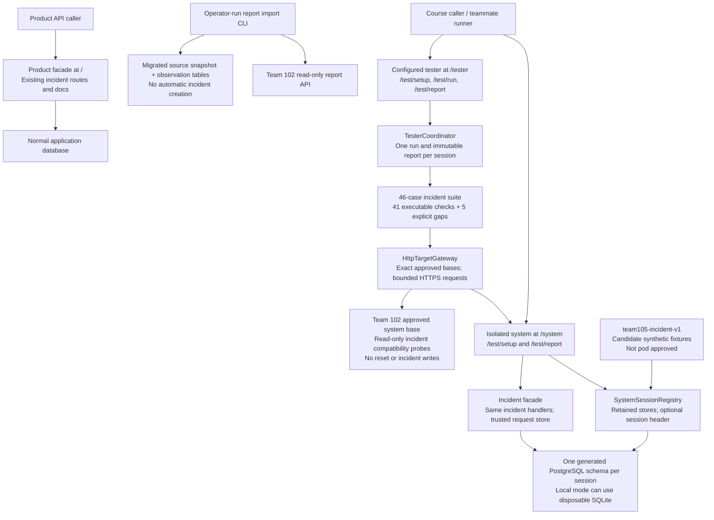
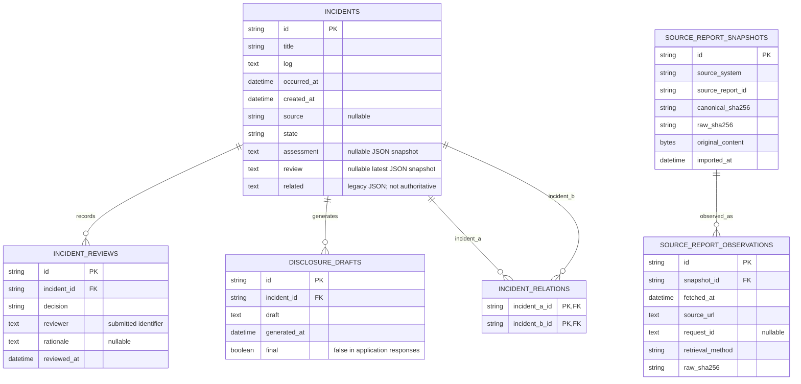
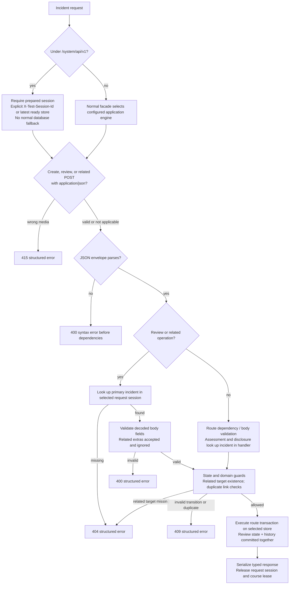

# Phase 4 system models

Updated November 1, 2026. These models describe the repository's Phase 4 delivery composition, including the isolated system and configured incident tester. They are **source models, not evidence that this composition is deployed**. The release commit, configured service entry point, live results, and registry entry must be recorded separately.

The product architecture supplied by the team remains a roadmap. Runtime AI extraction, administrator-approved reviewer accounts, reviewer authorization, deadline calculation, automated filing, and a product review UI are not implemented by this increment. The implemented assessment is the deterministic advisory screening in `triage.py`.

## Component and deployment model

The standalone diagram is [architecture.mmd](models/architecture.mmd).



`delivery_app:create_app` composes three facades. The product facade preserves the existing root incident API; `/system` exposes course controls and the same incident handlers with isolated storage; `/tester` exposes the configured HTTP runner. Product docs remain `/docs`, isolated incident docs are `/system/docs`, system-control docs are `/system/test/docs`, and tester docs are `/tester/docs`. `main:app` remains an independently usable product entry point; it does not select this delivery composition automatically.

The public factory requires an explicit `COURSE_TEST_DATABASE_URL`. Each course session owns a generated `sec450_course_*` schema with no `public` search-path fallback. Sharing the same physical database as the product store requires the explicit trusted `COURSE_TEST_ALLOW_SHARED_DATABASE=1` opt-in. This is storage isolation within our service, not an agreement to share a database with Team 102. Local mode may instead use disposable SQLite files.

The delivery uses **one worker**. It retains up to **32 system sessions and 32 tester sessions** in process memory; capacity rejects further setup rather than evicting stores or saved reports. System stores are retained until graceful shutdown. Reports and session routing do not survive a restart, and abrupt termination may leave course schemas requiring operator cleanup. One headerless suite may use the newest prepared session; explicit `X-Test-Session-Id` selects an older retained store. A store permits one active incident request, and setup is rejected while any incident request is active. These are documented local adapter choices, not a confirmed pod-wide session agreement.

Only the exact configured own `/system` base is authorized for reset and subsequent incident writes by this suite. An approved peer base permits transport access but does not grant permission for destructive tests. The current Team 102 target therefore receives read-only incident compatibility probes; its different logs/report API cannot be declared interchangeable with the nine-operation incident contract.

## Incident state model

The standalone diagram is [incident-state.mmd](models/incident-state.mmd).

```mermaid
stateDiagram-v2
    [*] --> RECEIVED: create incident
    RECEIVED --> POTENTIALLY_MATERIAL: assess; advisory flag true
    RECEIVED --> UNDER_REVIEW: assess; advisory flag false
    POTENTIALLY_MATERIAL --> MATERIAL_CONFIRMED: review MATERIAL
    POTENTIALLY_MATERIAL --> NOT_MATERIAL: review NOT_MATERIAL
    UNDER_REVIEW --> MATERIAL_CONFIRMED: review MATERIAL
    UNDER_REVIEW --> NOT_MATERIAL: review NOT_MATERIAL
    NOT_MATERIAL --> MATERIAL_CONFIRMED: later review MATERIAL
    MATERIAL_CONFIRMED --> MATERIAL_CONFIRMED: generate non-final draft; append version
    note right of RECEIVED
        Assessment only in RECEIVED.
        Review requires an assessed state.
        State violations return 409.
    end note
    note right of MATERIAL_CONFIRMED
        Human review is submitted data.
        No verified reviewer authentication exists.
        No downgrade or filing transition exists.
    end note
    state CLOSED
    note right of CLOSED
        Accepted enum / legacy state only.
        No public operation enters CLOSED.
        Review and related writes reject CLOSED.
    end note
```

Assessment is advisory: a false flag still enters `UNDER_REVIEW`. A human decision is required to reach either `MATERIAL_CONFIRMED` or `NOT_MATERIAL`; the latter can later escalate. Reassessment, repeated negative review, and a material downgrade are rejected. Assessment and review use conditional state updates so competing stale transitions return `409`; a successful review and its appended history record commit in one transaction. Disclosure creates another non-final draft without changing state. Related links do not change incident state.

`CLOSED` remains in the contract enum and list filter but has no implemented public transition. The model deliberately does not invent a close endpoint. Submitted reviewer text is not an authenticated identity, and a stored material decision is not legal approval or an SEC filing.

## Persistent data model

The standalone diagram is [data.mmd](models/data.mmd).



The four incident tables exist in the normal application store and independently in each course store. `incident_relations` stores each undirected relation once with the composite key `(incident_a_id, incident_b_id)` and check `incident_a_id < incident_b_id`; serialization obtains symmetric related IDs from this table. `incidents.related` is retained for legacy compatibility and backfill. `incidents.review` is the latest review snapshot; `incident_reviews` retains accepted decisions in append order. Old overwritten decisions cannot be reconstructed during legacy backfill.

The source-evidence tables are separate migration-owned metadata. Startup of the incident API does not create them. A unique `(source_system, source_report_id, canonical_sha256)` identifies each semantic source snapshot, preserving its first raw representation; every fetch adds an observation with its raw digest and retrieval provenance. Fixture and API sources have separate identities. Snapshot plus observation writes are transactional. No foreign key links this evidence to incidents because report-to-incident mapping and duplicate coordination are not yet implemented. The diagram therefore does not imply an ingestion pipeline that already creates reviewable incidents.

The incident reset deletes the four incident tables in dependency order. Under `/system`, it then reseeds the configured candidate fixtures in the same transaction. Product-root reset remains delete-only and does not delete the source snapshot or observation tables. Candidate fixture labels are synthetic engineering oracles, not agreed materiality labels.

## Request and validation model

The standalone diagram is [request-flow.mmd](models/request-flow.mmd).



The precedence shown for primary lookup before field validation applies to **review and related** bodies. FastAPI parses the JSON envelope first, so malformed JSON returns syntax `400` before dependency lookup. Media checks precede those operations. Related-target lookup happens after a valid `relatedIncidentId` body; absence returns `404`. Other routes retain their own declared body/dependency behavior. All operations resolve their SQLAlchemy session from server-owned state; request parameters cannot choose a database.

Create timestamps must be timezone-bearing RFC 3339 strings; numeric epochs, dates, and naive timestamps are invalid. Optional input `source` and review `rationale` can be omitted but cannot be explicit `null`; their response fields may be `null`. Create and review bodies reject extra fields, while related bodies accept and ignore extras as the recovered contract specifies. Responses use the typed incident/assessment/disclosure schemas. The original versioned contract remains separate from the generated OpenAPI.

## Tester lifecycle model

The standalone diagram is [tester-lifecycle.mmd](models/tester-lifecycle.mmd).

```mermaid
stateDiagram-v2
    [*] --> PREPARING: POST /test/setup with approved target_url
    PREPARING --> READY: target setup returns 201 with matching session_id
    PREPARING --> [*]: preparation fails; reservation released; no tester session
    READY --> RUNNING: first POST /test/run claims session
    RUNNING --> COMPLETED: all cases attempted and final report stored
    RUNNING --> ABORTED: timeout, cancellation, or unexpected runner failure
    COMPLETED --> COMPLETED: GET /test/report returns detached stored snapshot
    ABORTED --> ABORTED: GET /test/report returns partial report with remaining skips
    note right of READY
        GET report before completion returns 409.
        Unknown session returns 404.
    end note
    note right of RUNNING
        Another run returns 409.
        Case-level target failures are results;
        they need not abort the suite.
    end note
    note right of COMPLETED
        Completed and aborted sessions cannot rerun.
        Session/report retention is process-local.
        Capacity rejects new setup without eviction.
    end note
```



Delivery setup has a 30-second deadline; a suite has a 90-second deadline, with bounded individual HTTP calls. A returned target error is classified as a case result where possible. On runner abort, the active interrupted case becomes an error and unstarted cases become skips; the partial report is retained. Run or report counts do not establish source line coverage. Uninstrumented code coverage and unagreed component/system inventories remain `null` with an explanatory basis.

The 46-case inventory includes five explicit unresolved checks for shared fixture agreement, shared classification labels, closure, failure injection, and disclosure content quality. Those skips remain visible even when every executable self-check passes. Bidirectional deployed testing and pod agreement are separate evidence requirements.

## Consistency and verification references

| Model | Implementation anchor | Verification anchor |
| --- | --- | --- |
| Composition and store isolation | `delivery_app.py`, `course_system.py`, `system_sessions.py`, `main.create_incident_app` | `test_system_sessions.py`, `test_database.py`, delivery integration tests |
| Incident transitions and transaction boundaries | `main.assess`, `main.review`, `main.relate`, `main.disclosure` | `test_api.py`, `test_review.py`, `test_disclosure.py`, `test_concurrency.py` |
| Incident and source data | `main` ORM rows, `report_import_store.py`, `migrations/versions/0002_report_imports.py` | Relationship/history tests and `test_report_import_store.py` |
| Request preparation and wire constraints | `request_models.py`, `request_preparation.py`, `contract_schemas.py` | `test_request_models.py`, `test_request_preparation.py`, `test_request_alignment.py`, `contract_audit.py` |
| Tester lifecycle and target access | `tester_core.py`, `tester_http.py`, `tester_targets.py`, `incident_suite.py` | `test_tester_core.py`, `test_tester_http.py`, `test_tester_targets.py`, `test_incident_suite.py` |

Preserve this distinction when preparing the submission: a model documents what the code does; a passing local test documents an observed local behavior; only a run against the identified deployed commit supports a deployed result. Shared fixture approval, the pod's current interface scope, and both directions of cross-team testing remain coordination and evidence work.
